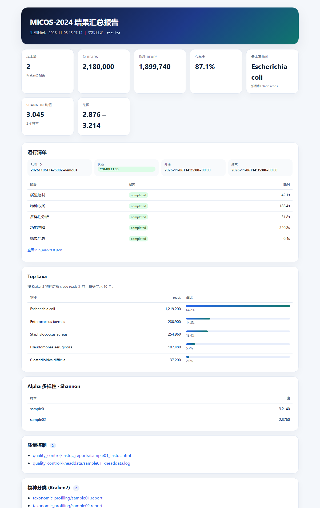
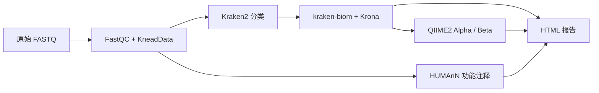

# MICOS-2024: 宏基因组综合分析套件

*Metagenomic Intelligence and Comprehensive Omics Suite*

<div align="center">

[](https://github.com/open-genomics/micos-2024/actions/workflows/ci.yml)
[](https://open-genomics.github.io/micos-2024/)
[](https://codecov.io/gh/open-genomics/micos-2024)
[](https://www.python.org/)
[](https://opensource.org/licenses/MIT)

**从原始 FASTQ 到可解释的微生物组结果：质控、物种分类、多样性、功能注释和 HTML 报告，一条 CLI 串联。**

[快速开始](#快速开始) • [输出示例](#一条命令得到什么) • [可复现性](#可复现性) • [文档](https://open-genomics.github.io/micos-2024/) • [状态与边界](#状态与边界)

</div>

> 本项目起源于 2024“猛犸杯”国际生命科学数据创新大赛，现由 [Open Genomics](https://github.com/open-genomics) 作为长期工具维护。赛事背景见[项目起源](docs/zh/research/competition.md)。



## 为什么是 MICOS-2024

- **一条命令跑通主链路**：`micos full-run` 串联 FastQC/KneadData、Kraken2、kraken-biom/Krona、QIIME2 和 HUMAnN。
- **结果可追溯**：每次运行写出 `run_manifest.json`，记录软件版本、数据库路径、输入文件、参数和每个阶段的耗时/状态。
- **报告是分析结果，不是文件列表**：自包含 HTML 报告包含运行清单、样本数、分类率、Top taxa、Alpha 多样性和产物索引。
- **模块可单独运行**：每个阶段都有 `micos run <module>` 子命令，便于调试、替换或接入外部流程。
- **诚实的边界**：WDL 是实验性单步骤参考，容器资产是部分步骤参考，当前不支持断点续传，也没有原生 HPC 调度器集成。

## 一条命令得到什么

| 输入 | 输出 |
| --- | --- |
| 双端 FASTQ（`*_R1.fastq.gz` / `*_R2.fastq.gz`） | 质控报告、清洗读段、Kraken2 报告、BIOM 表、Krona 图 |
| 可选样本元数据（`sample-id` 或 `#SampleID`） | QIIME2 Alpha/Beta 产物与 TSV、HUMAnN 功能表 |
| KneadData / Kraken2 数据库 | `run_manifest.json` + `micos_summary_report.html` |

## 快速开始

### 方式 A：uv（推荐本地开发）

```bash
git clone https://github.com/open-genomics/micos-2024.git
cd micos-2024

uv sync --extra dev
uv run micos doctor

uv run micos full-run \
  --input-dir data/raw_input \
  --results-dir results \
  --threads 16 \
  --kneaddata-db /path/to/kneaddata_db \
  --kraken2-db /path/to/kraken2/standard
```

### 方式 B：Conda（完整生信工具链）

```bash
git clone https://github.com/open-genomics/micos-2024.git
cd micos-2024

mamba env create -f environment.yml
conda activate micos-2024
pip install -e .

micos doctor
./scripts/verify_installation.sh
```

> `environment.yml` 负责安装外部生信工具；`pip install -e .` 负责安装 `micos` 命令行本身。两步都需要。

### 方式 C：容器与工作流资产

仓库提供部分步骤的 Dockerfile / Singularity 定义，以及实验性 WDL 单步骤参考。它们**不是**一键全流程镜像或生产工作流；生产分析仍请使用 `micos full-run`。详见[部署模式](docs/zh/guides/deployment.md)。

## 输入约定

- `full-run` 目前按**双端测序**流程设计，R1 命名形如 `sample_R1.fastq.gz`，R2 命名形如 `sample_R2.fastq.gz`。
- `--metadata` 可选；按 `sample-id` 列与 FASTQ 文件名提取的样本名 join。兼容 QIIME 风格的 `#SampleID` 表头。
- 数据库路径必须指向真实目录，不能保留 `/path/to/...` 或 `${...}` 占位符。
- Kraken2 standard 和 HUMAnN 数据库通常为数十 GB 到上百 GB；请预留充足磁盘空间，并在运行前用 `micos doctor` 检查路径。

```bash
cp config/analysis.yaml.template config/analysis.yaml
cp config/databases.yaml.template config/databases.yaml
cp config/samples.tsv.template config/samples.tsv
micos validate-config --config config/analysis.yaml
```

## 分析流程



阶段顺序、跳过开关和参数来源可以通过 dry-run 查看：

```bash
micos --dry-run full-run --input-dir data/raw_input --results-dir results
```

## 输出说明

| 产物 | 路径 | 说明 |
| --- | --- | --- |
| 运行清单 | `results/run_manifest.json` | 软件版本、数据库路径、输入文件、参数、阶段状态/耗时 |
| 汇总报告 | `results/micos_summary_report.html` | 自包含 HTML：概览卡片、Top taxa、Alpha 表、运行清单、产物索引 |
| 质量控制 | `results/quality_control/` | FastQC 报告、KneadData 清洗读段与日志 |
| 物种分类 | `results/taxonomic_profiling/` | Kraken2 报告、BIOM 表、Krona 图 |
| 多样性 | `results/diversity_analysis/` | QIIME2 `.qza`、Alpha TSV、Beta 距离矩阵 TSV |
| 功能注释 | `results/functional_annotation/` | HUMAnN 基因家族、通路丰度/覆盖度表 |

## 项目结构

```text
.
├── micos/                  # Python 包：CLI、编排、manifest、报告
├── scripts/                # Shell 包装层、数据库下载、专家分析脚本
├── steps/                  # 实验性 WDL 单步骤参考
├── containers/             # Singularity 等环境资产（部分步骤）
├── config/                 # 分析、数据库、样本元数据模板
├── docs/                   # VitePress 文档站
├── tests/                  # pytest 单元测试与文档一致性测试
└── data/raw_input/         # 输入 FASTQ 放置目录
```

## 可复现性

`run_manifest.json` 是项目的“运行合同”。每次 `full-run` 都会记录：

- `run_id`、开始/结束时间、整体状态
- MICOS 版本、Python 版本、平台、git commit
- 外部工具路径与版本
- 数据库路径及是否存在
- 输入 FASTQ 的相对路径、大小、mtime
- 每个阶段的 `completed` / `skipped` / `failed` 状态、耗时和错误摘要

开始前可以独立检查环境：

```bash
micos doctor
micos doctor --json
```

> 当前**不支持断点续传**；失败后建议保留 `results/` 与 `run_manifest.json` 用于排错，再重新运行。不同项目请使用不同的 `--results-dir`，避免互相覆盖。

## 状态与边界

| 能力 | 状态 |
| --- | --- |
| Python CLI `micos full-run` | 生产入口 |
| QC / 分类 / 多样性 / 功能注释模块 | Beta，依赖外部工具与数据库 |
| 自包含 HTML 报告 | 可用 |
| `run_manifest.json` | 可用 |
| WDL 单步骤 | 实验性单步骤参考，不是生产工作流 |
| Docker / Singularity | 部分步骤参考，未发布统一镜像 |
| 断点续传 | 当前不支持 |
| HPC 调度 | 单机多线程；可由 Slurm/PBS 提交，但没有原生调度器集成 |
| `scripts/` 扩展分析 | 独立脚本，不属于稳定 CLI 接口 |

## WDL 任务定义（实验性）

> **注意**：`steps/` 中的 WDL 文件是**实验性单步骤参考**，不是生产工作流。
> 当前没有顶层 WDL workflow、固定运行时输入或执行验证 CI。
> 生产分析请使用 `micos full-run`。

各分析步骤的 WDL 任务定义位于 `steps/` 目录（01–06），可用 Cromwell 等引擎单独运行：

```bash
java -jar cromwell.jar run \
  steps/03_taxonomic_profiling_kraken/kraken2.wdl \
  --inputs steps/03_taxonomic_profiling_kraken/kraken2.json
```

## 配置与文档

| 文档 | 说明 |
| --- | --- |
| [快速开始](docs/zh/guides/getting-started.md) | 安装、配置与首次运行 |
| [配置系统](docs/zh/configuration.md) | 配置优先级、路径解析与严格校验 |
| [CLI 参考](docs/zh/reference/cli.md) | 全部命令、参数与返回码 |
| [系统总览](docs/zh/architecture/system-overview.md) | 分层架构与执行面 |
| [测试策略](docs/zh/architecture/testing-strategy.md) | 当前测试覆盖与未覆盖边界 |
| [故障排除](docs/zh/troubleshooting.md) | 常见问题与解决方案 |

## 引用

如果 MICOS-2024 对你的研究有帮助，请引用本仓库；引用元数据见 [CITATION.cff](CITATION.cff)。使用特定工具时，也请同时引用 Kraken2、QIIME2、KneadData、HUMAnN、Krona 等上游工具。

## 贡献与帮助

欢迎社区贡献！详情请参阅[贡献指南](CONTRIBUTING.md)。

- **报告问题 / 功能建议**：[GitHub Issues](https://github.com/open-genomics/micos-2024/issues)
- **故障排除**：[常见问题](docs/zh/troubleshooting.md)
- **仓库讨论**：GitHub Discussions 尚未开启；请先使用 Issues。

## 起源与致谢

MICOS-2024 起源于 2024“猛犸杯”国际生命科学数据创新大赛，聚焦宏基因组学方向。赛事背景、时间线和赛题说明见[项目起源](docs/zh/research/competition.md)。

感谢华大生命科学研究院、深圳国家基因库、崖州湾科技城管理局提供的赛事平台与支持。

感谢以下开源项目：

- [Kraken2](https://ccb.jhu.edu/software/kraken2/) — 分类学分类
- [QIIME2](https://qiime2.org/) — 微生物组数据分析
- [KneadData](https://github.com/biobakery/kneaddata) — 质量控制
- [HUMAnN](https://huttenhower.sph.harvard.edu/humann/) — 功能注释
- [Krona](https://github.com/marbl/Krona) — 交互式可视化
- [Phyloseq](https://joey711.github.io/phyloseq/) — 扩展脚本中的生态分析

## 许可证

本项目采用 [MIT 许可证](LICENSE)。
